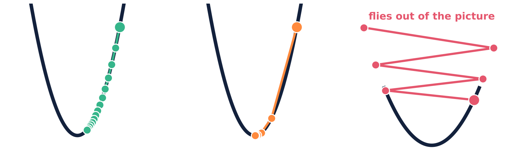

# Module 04: Convolutional Neural Networks

## A04: Deep Learning for an 11 Year Old (gradient descent)

A04 was posted in this module. I chose gradient descent as the idea to explain, since every network in the course, CNNs included, learns with it.

Assignment: explain one deep learning idea so an 11 year old could follow it. I picked gradient descent, because every model in this course learns with some version of it.

## Files

- `A04_Solo_TrilokKalani_ITAI2376.pptx` - slides with full speaker notes
- `loss_hill.png`, `learning_rate_comparison.png` - two of the figures from the deck

## The story in the slides

A robot guesses a pizza costs $100 when it really costs $12. We give it a score for how wrong it is (the loss) and draw that score as a hill. Then it plays the foggy mountain game: eyes closed, feel which way the ground tilts, take a step downhill, repeat until it is flat. The slope is the gradient, the step size is the learning rate, and the flat spot is the minimum.

The learning rate picture was the part people remembered: steps that are too small take forever, a good size gets there quickly, and steps that are too big bounce around and fly out of the picture.

## What I took away

Explaining something to a kid shows you which parts you only half understand. I had to decide what to leave out (no calculus) without saying anything that would be wrong later.

## Main sources

- Video: 3Blue1Brown, Gradient descent, how neural networks learn. https://www.youtube.com/watch?v=IHZwWFHWa-w
- Zhang, A., Lipton, Z. C., Li, M., and Smola, A. J. Dive into Deep Learning, sections 11.3 (gradient descent), 11.4 (SGD) and 11.6 (momentum). https://classic.d2l.ai/chapter_optimization/gd.html

All charts were drawn with matplotlib from the update rule x = x - lr * 2x on the curve x^2, starting at 8.
