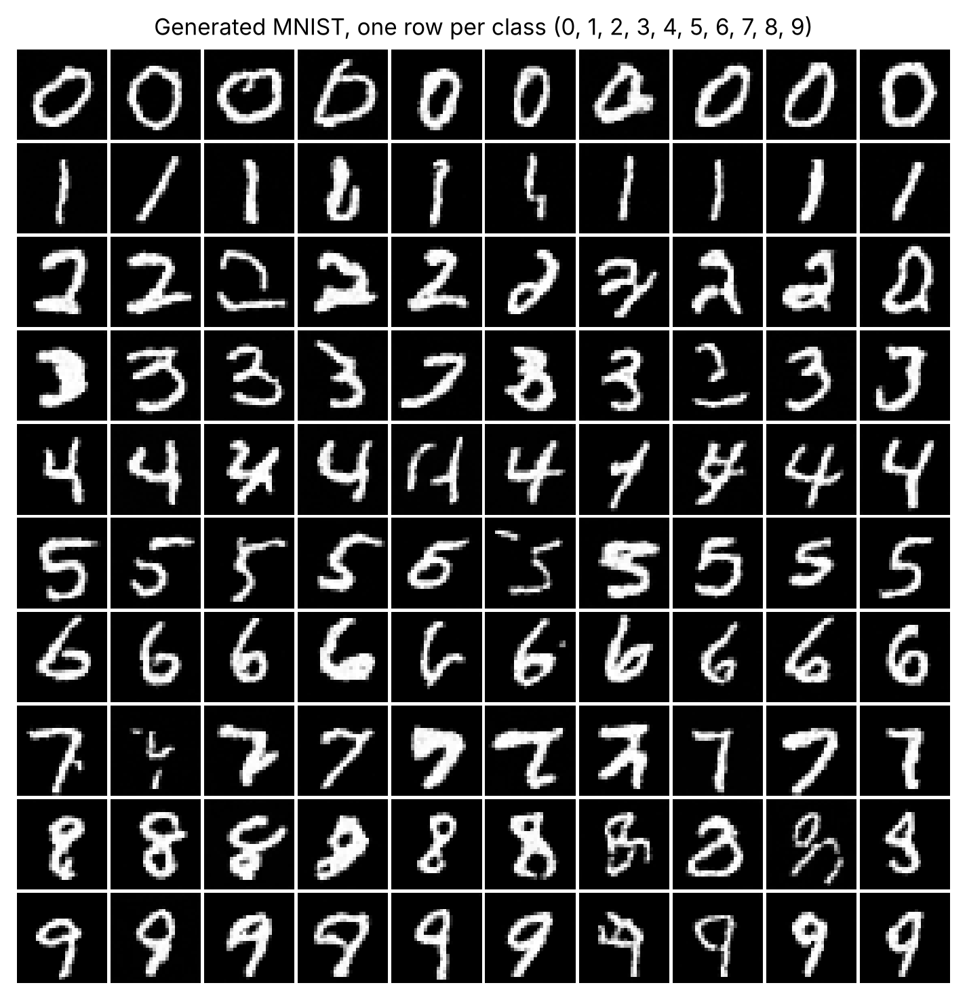

# Module 09: Generative AI with Diffusion Models

## Midterm: Creating Images with Diffusion Models

Assignment: build a class-conditional diffusion model with a U-Net, generate digits, use CLIP to evaluate and improve generation, and answer the report questions.

## Files

- `MD_Notebook_Trilok_Kalani_ITAI.ipynb` - the full notebook, executed top to bottom with outputs saved
- `MD_Report_Trilok_Kalani_ITAI.pdf` / `.docx` - the report (13 pages, 14 figures)
- `figures/` - the main plots pulled out of the notebook

The starter notebook for this assignment was not posted in the course, so I wrote the notebook myself using the names from the assignment (GELUConvBlock, UpBlock, q_sample, train_step).

## Setup

MNIST, T = 1000 steps with a linear beta schedule, U-Net with base width 32 (0.733M parameters), 10 epochs, AdamW, EMA 0.995. I only had a CPU, so I used a smaller setting than the default; the config cell says this and the full setting runs on a Colab GPU.

## Results

| | |
|---|---|
| Training time (CPU) | 33.3 minutes |
| Final validation loss | 0.0239 |
| Generated digits classified correctly by a separate CNN | 95% (weakest digit: 3, at 80%) |
| Classifier-free guidance w = 2 | 100% correct, about 10% less diversity |
| DDIM with 50 steps | about 20x faster, 93% vs 96% |

## What I took away

Most of the image gets destroyed between about t = 200 and t = 500, and in reverse the digits only become readable near the end, around t = 199. The model's own guess of the clean image (x0-hat) shows the shape much earlier, around t = 899. Guidance was a clear trade: more accurate digits, less variety. I also learned how much a CPU limits you, and why it matters to say exactly what settings you actually ran.

## Main sources

- Ho, J., Jain, A., and Abbeel, P. (2020). Denoising diffusion probabilistic models. arXiv:2006.11239
- Sohl-Dickstein, J., et al. (2015). Deep unsupervised learning using nonequilibrium thermodynamics. ICML
- Song, J., Meng, C., and Ermon, S. (2021). Denoising diffusion implicit models (DDIM). ICLR
- Ho, J., and Salimans, T. (2022). Classifier-free diffusion guidance. arXiv:2207.12598
- Ronneberger, O., Fischer, P., and Brox, T. (2015). U-Net. MICCAI
- Radford, A., et al. (2021). Learning transferable visual models from natural language supervision (CLIP). ICML
